# insurance-pricing-and-claims

Pricing, reserving and claims screening for a non-life motor book, built on public data:

1. Pricing: claim frequency, severity and pure premium with GLMs and Optuna-tuned XGBoost, 5-fold
   cross-validated, with a balance correction of the totals and a loss-ratio view of premium adequacy.
2. A second market: the same frequency pipeline on a 2022-2024 Spanish motor portfolio, to see what
   carries over from the French data and what does not.
3. Claims reserving: chain-ladder, Mack, Bornhuetter-Ferguson, bootstrap ODP.
4. Severity-anomaly screening: claims that are unusual against the model-predicted severity, with
   reason codes.

CLI: `ins-ml reconcile | pricing | spain | reserving | fraud | all`. Every number below comes from
that code run on the real data; the tables are committed under [`results/`](results/).

## Why I built this

Insurance modelling write-ups often stop at one train/test split and a Gini. As an audit analytics
lead I look at the other end: would the total reproduce, would the premium be adequate by risk class,
and does the finding survive a different fold or a different portfolio? So the pricing study is built
the way I would want it evidenced. Metrics are mean and standard deviation over folds, hyper-parameters
are tuned on data that never enters the evaluation, the totals are corrected out of sample, and the
result is checked against premium and against a second country.

## Data and licenses

| Data | Source | License | Used for |
|---|---|---|---|
| freMTPL2freq (678,013 policies) and freMTPL2sev (26,639 claim amounts) | French motor third-party liability portfolio from the R package [CASdatasets](https://github.com/dutangc/CASdatasets) (Dutang and Charpentier), mirrored on OpenML ids [41214](https://www.openml.org/d/41214) and [41215](https://www.openml.org/d/41215). Fetched with `sklearn.datasets.fetch_openml`. | CC0 as listed on OpenML | Pricing, screening |
| Spanish motor portfolio 2022-2024, 354,140 policy-years, with exposure, premium, claims and incurred cost by coverage | Espinosa, Lledo and Atance (2026), *Data in Brief*, [doi:10.1016/j.dib.2026.112883](https://doi.org/10.1016/j.dib.2026.112883). Mendeley Data [doi:10.17632/sw4jmdb2sm.1](https://doi.org/10.17632/sw4jmdb2sm.1). Downloaded by `ins-ml spain` from the public file URL and checked against its SHA-256. | CC BY 4.0 | Second market, premium adequacy |
| GenIns triangle (Taylor and Ashe, 1983) | Sample data shipped with the [`chainladder`](https://github.com/casact/chainladder-python) package | Package is MPL-2.0; the triangle is a published academic example | Chain-ladder, Mack, bootstrap |
| CAS Loss Reserving Database, commercial auto, net paid and earned premium, accident years 1988-1997 | Meyers and Shi (2011), Casualty Actuarial Society, shipped with `chainladder` | Free public download from the CAS | Bornhuetter-Ferguson |

Raw data are cached under the gitignored `data/` folder and are never committed. Changes made to the
Spanish data are described under "Spanish portfolio"; it is not redistributed here.

- Dutang, C. and Charpentier, A. (2018). CASdatasets: Insurance datasets. R package.
- Espinosa, P., Lledo, J. and Atance, D. (2026). A detailed dataset of motor insurance policies with
  coverage-specific financial information. *Data in Brief*; Mendeley Data, V1, doi:10.17632/sw4jmdb2sm.1.
- Taylor, G. C. and Ashe, F. R. (1983). Second moments of estimates of outstanding claims. *Journal of
  Econometrics* 23, 37-61.
- Meyers, G. G. and Shi, P. (2011). Loss Reserving Data Pulled from NAIC Schedule P. Casualty Actuarial
  Society.
- Denuit, M., Charpentier, A. and Trufin, J. (2021). Autocalibration and Tweedie-dominance for insurance
  pricing with machine learning. *Insurance: Mathematics and Economics* 101.
- Akiba, T. et al. (2019). Optuna: a next-generation hyperparameter optimization framework. *KDD*.

## The claims tables do not match, and what I did about it

The frequency table counts 36,102 claims (36,056 after capping `ClaimNb` at 4). The severity table has
26,639 amounts. The old shortcut was to scale the pure premium by 0.734. The data allows something
better. I aggregate the severity table to one record per policy and join on `IDpol`; each policy then
falls in one class:

| Class | Policies | Claims in frequency table | Amounts in severity table | Mean exposure |
|---|---|---|---|---|
| No claim | 643,953 | 0 | 0 | 0.52 |
| Every claim has an amount | 24,943 | 26,443 | 26,443 | 0.69 |
| Claims, none with an amount | 9,116 | 9,657 | 0 | 0.51 |
| Some claims lack an amount | 1 | 2 | 1 | 0.82 |

Another 195 severity rows (788,714 in total amount) belong to policies that are not in the frequency
table and cannot be joined; they are left out. Missing amounts come whole policies at a time, and
they are not random: among claim-bearing policies the share with an amount rises with exposure, from
37% below 0.1 years to 81% above 0.75 years. I cannot tell from the data whether those claims were
closed without payment or not yet valued. So I model what is observed. The pure-premium chain uses the
number of claims that carry an amount as its frequency, so frequency and severity describe the same
events and no scaling factor is needed. Exposure band enters the amount-based models as a covariate
(and as a feature for the boosted ones), and is set to a full year for an annual price. Claim
frequency in the plain sense (all reported claims) is modelled separately and is the figure compared
across markets.

## Method

Preparation: `ClaimNb` capped at 4, `Exposure` at 1 year, `VehPower` at 9, `VehAge` at 20, `DrivAge` at 90,
`BonusMalus` at 150. Single claims are capped at 100,000 for severity and pure-premium work (the largest
raw claim is 4.08m).

Validation design. A random 20% tuning slice (135,633 policies) is set aside and used only to tune
the boosting hyper-parameters. The other 80% (542,380 policies) is split into 5 folds; each model is
refitted on four folds and scored on the fifth. Tables report mean and sd over the five folds
(sd with n-1). Calibration, double-lift, Lorenz and loss-ratio views use the pooled out-of-fold
predictions.

Models.
- Frequency, all claims: Poisson GLM (log link, `log(Exposure)` offset; banded driver age, vehicle age,
  bonus-malus and density plus vehicle power, brand, fuel, region) and XGBoost with a Poisson
  objective (exposure as base margin, native categorical splits).
- Frequency of claims with an amount: the same two models, with exposure band added.
- Severity: Gamma GLM and XGBoost Gamma, on mean amount per policy weighted by claim count.
- Pure premium: Freq x Sev GLM, Tweedie GLM (p = 1.5), XGBoost freq x XGBoost sev, and XGBoost Tweedie
  (p = 1.5). The Tweedie power is fixed; I did not tune it.
- Optuna (TPE, seed 42): 25 trials per boosted model, 3-fold validation negative log-likelihood with
  early stopping, over depth, learning rate, min child weight, subsample, column sample and two
  penalties. Chosen values are in `results/tuned_params.json`, the trials in `results/optuna_trials.csv`.

Balance correction. Log-link Gamma and Tweedie GLMs and early-stopped boosting do not reproduce the
portfolio total. I fit, on out-of-fold predictions of the other four folds only, either one
multiplicative factor (sum of actual over sum of predicted) or an exposure-weighted isotonic regression
of the observed rate on the predicted rate (autocalibration, Denuit et al. 2021), floored at 5% of the
average rate so that a claim on a policy predicted at zero cannot give an infinite deviance. The fold
being scored never sees its own correction.

Premium adequacy. The French data has no premium. I take the balance-corrected Freq x Sev GLM as the
incumbent tariff, load it to a 70% loss ratio, and ask where the loss ratio goes when policies are
ranked by the challenger (XGBoost Tweedie, corrected). The Spanish data has the premium actually
charged, so there the loss ratio is the real one.

## Results

### Claim frequency, all reported claims (5-fold CV, 542,380 policies)

| Model | Mean Poisson deviance | Gini (claims) | Predicted / actual |
|---|---|---|---|
| Null (portfolio mean) | 0.3301 +/- 0.0047 | 0.000 | 1.000 +/- 0.016 |
| Poisson GLM | 0.3134 +/- 0.0044 | 0.285 +/- 0.002 | 1.000 +/- 0.017 |
| XGBoost Poisson | 0.3030 +/- 0.0046 | 0.338 +/- 0.003 | 1.001 +/- 0.021 |

For claims with an amount the picture is the same (deviance 0.2333 vs 0.2397, Gini 0.372 vs 0.324;
`results/frequency_amount_cv.csv`).

### Severity

| Model | Gamma deviance | Predicted / actual |
|---|---|---|
| Null (portfolio mean) | 1.300 +/- 0.050 | 1.001 +/- 0.034 |
| Gamma GLM | 1.318 +/- 0.053 | 1.000 +/- 0.039 |
| XGBoost Gamma | 1.299 +/- 0.050 | 0.992 +/- 0.037 |

The rating factors carry almost no information about the size of a claim in this data. The Gamma GLM
does worse than the portfolio mean out of fold, and boosting only matches it. Whatever the pure
premium models gain comes from frequency.

### Pure premium (loss capped at 100,000 per claim), raw predictions

| Model | Tweedie deviance (p=1.5) | Gini (loss) | Predicted / actual |
|---|---|---|---|
| Null (portfolio mean) | 77.43 +/- 1.40 | 0.000 | 1.001 +/- 0.044 |
| Freq x Sev GLM | 72.20 +/- 1.85 | 0.373 +/- 0.036 | 1.001 +/- 0.043 |
| Tweedie GLM | 71.69 +/- 1.71 | 0.393 +/- 0.025 | 1.012 +/- 0.044 |
| XGBoost freq x XGBoost sev | 70.07 +/- 1.82 | 0.433 +/- 0.034 | 0.992 +/- 0.046 |
| XGBoost Tweedie | 70.70 +/- 1.81 | 0.415 +/- 0.030 | 0.946 +/- 0.044 |

On the earlier single split the XGBoost Tweedie model under-predicted the total by about 10%. With
five folds the shortfall is 5.4% on average, so part of that earlier figure was one split's luck, and
the rest is a real bias. The sd of 4% on the ratio is the large-claim noise that any single total
carries.

### Balance correction, before and after

| Model | Variant | Predicted / actual | Tweedie deviance | Gini (loss) |
|---|---|---|---|---|
| XGBoost Tweedie | raw | 0.946 +/- 0.044 | 70.70 | 0.415 |
| XGBoost Tweedie | balance factor | 1.002 +/- 0.059 | 70.68 | 0.415 |
| XGBoost Tweedie | isotonic | 1.006 +/- 0.058 | 70.88 | 0.411 |
| XGBoost freq x sev | raw | 0.992 +/- 0.046 | 70.07 | 0.433 |
| XGBoost freq x sev | balance factor | 1.002 +/- 0.058 | 70.09 | 0.433 |
| Tweedie GLM | raw | 1.012 +/- 0.044 | 71.69 | 0.393 |
| Tweedie GLM | balance factor | 1.002 +/- 0.055 | 71.70 | 0.393 |

The factor removes the bias without touching the ranking. The sd of the ratio goes up slightly
(0.044 to 0.059) because the factor is itself estimated on other folds and carries their noise; the
fold total is dominated by a few large claims either way. Isotonic autocalibration does not buy
anything over the single factor here and costs a little Gini. Full set in
`results/pure_premium_balance_cv.csv`; by decile for XGBoost Tweedie in
`results/calibration_pure_premium_xgb.csv`.

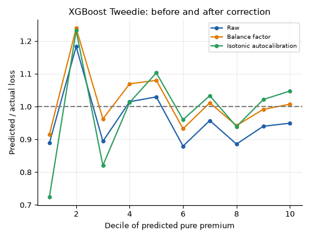

### Premium adequacy: loss ratio by predicted decile

Premium = balance-corrected Freq x Sev GLM pure premium / 0.70. Index = decile loss ratio over
portfolio loss ratio, pooled out-of-fold, equal exposure per decile.

| Decile | Ranked by challenger: loss ratio | Index | Ranked by incumbent: loss ratio | Index |
|---|---|---|---|---|
| 1 (lowest risk) | 0.43 | 0.61 | 0.70 | 1.01 |
| 2 | 0.40 | 0.56 | 0.65 | 0.93 |
| 3 | 0.54 | 0.78 | 0.57 | 0.82 |
| 4 | 0.53 | 0.75 | 0.61 | 0.88 |
| 5 | 0.59 | 0.85 | 0.67 | 0.96 |
| 6 | 0.77 | 1.10 | 0.69 | 0.99 |
| 7 | 0.73 | 1.05 | 0.72 | 1.03 |
| 8 | 0.78 | 1.12 | 0.75 | 1.08 |
| 9 | 0.75 | 1.08 | 0.77 | 1.10 |
| 10 (highest risk) | 0.81 | 1.16 | 0.69 | 0.99 |

Ranked by the incumbent itself the loss ratio is roughly flat, as it should be. Ranked by the
challenger it climbs from 0.43 to 0.81: the lowest-risk half of the book, as the boosted model sees
it, runs at 0.40 to 0.59 against a 0.70 target, and the highest-risk decile at 0.81. A competitor
using the boosted ranking could take the first group at a lower price and leave the incumbent with
the second. The gradient is the argument for the challenger; it is not a pricing recommendation,
since the 0.70 loading and the incumbent are my assumptions.

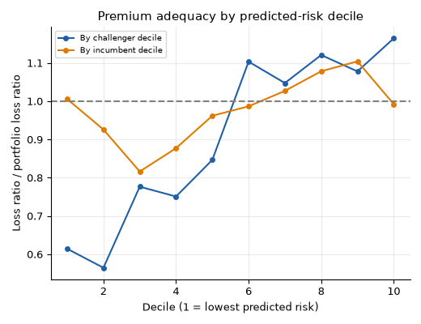

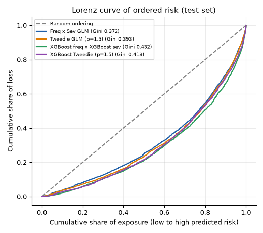

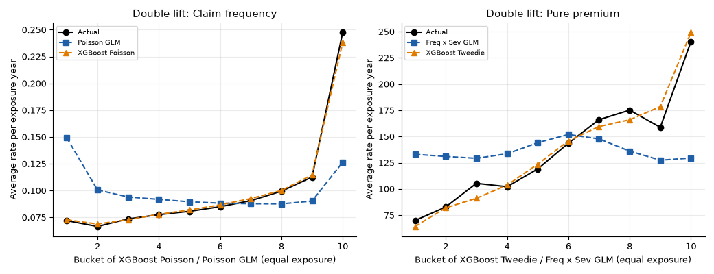

Double lift on frequency: in the 10% of policies where XGBoost is most below the GLM, observed
frequency is 0.072 against a GLM prediction of 0.149; where XGBoost is most above, 0.247 against 0.126.
The GLM misses interactions the boosted model finds.

### Calibration by decile of predicted frequency (pooled out-of-fold)

Both models are within about 4% of actual in every decile (XGBoost: 0.975 to 1.038;
`results/calibration_xgb.csv`, `results/calibration_glm.csv`).

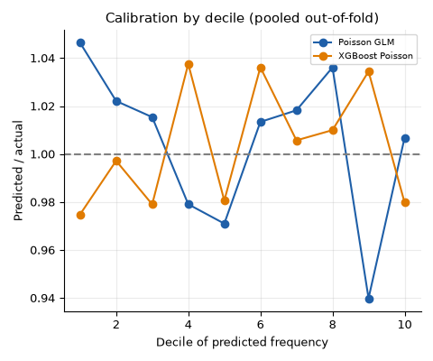

### Interpretability

GLM frequency relativities (reference level = 1, 95% CI in `results/relativities_frequency.csv`):

| Factor | Level: relativity |
|---|---|
| Driver age | 18-21: 1.07, 22-25: 0.75, 26-30: 0.63, 31-40: 0.72, 41-50: 1.00 (ref), 51-60: 0.95, 61-70: 0.94, 71+: 1.01 |
| Bonus-malus | 50: 1.00 (ref), 51-60: 1.34, 61-70: 2.00, 71-80: 1.91, 81-100: 2.54, 101-125: 5.34, 126+: 6.86 |

Mean absolute SHAP of the boosted frequency model: bonus-malus 0.296, vehicle age 0.187, driver age
0.130, brand 0.069, log density 0.068, region 0.068, vehicle power 0.059, fuel 0.025, area 0.012.

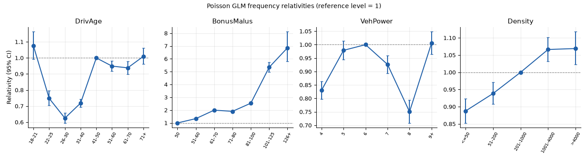

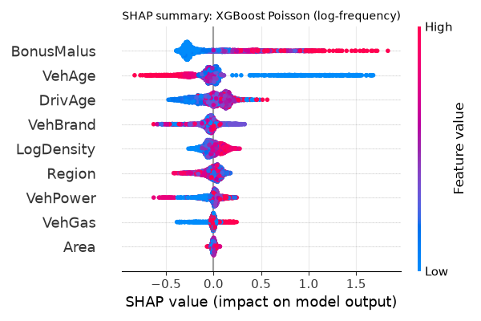

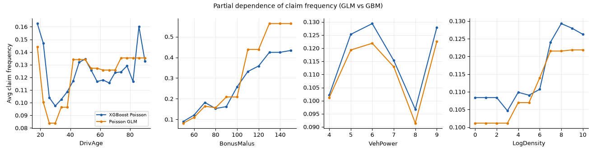

### A second market: Spanish motor portfolio, 2022-2024

The file has one row per policy-year with exposure, premium, claim counts and incurred cost by
coverage. I use the third-party liability columns as the counterpart of French MTPL: 354,091 policy-years
with positive exposure, 185,677 policyholders, 250,326 exposure years, 37,692 claims (frequency 0.151
against 0.101 in France), liability premium 64.0m, capped incurred 45.1m, loss ratio 0.705.

What I changed or found in the file:
- The same policyholder appears in up to three years, so folds are grouped by `insured_id`; a random
  split would leak.
- `vehicle_age` equals `driver_age - age_driving_licence` in 91% of rows and rises by one every year,
  so it behaves as years since the licence was issued, not vehicle age. I use it as `licence_years`.
  The file has no genuine vehicle age.
- `policy_status` (cancelled or active) is not used as a feature, since it is known only afterwards.
- Incurred is capped at 100,000 per policy-year; claim-level amounts are not available. Missing vehicle
  value (513 rows) and licence years (2 rows) are set to the median.

Same pipeline, 5-fold CV grouped by policyholder, 283,475 rows after a 20% grouped tuning slice:

| | France | Spain |
|---|---|---|
| Claim frequency per exposure year | 0.101 | 0.151 |
| GLM deviance gain over null | 5.1% | 0.8% |
| XGBoost deviance gain over GLM | 3.3% | 0.0% |
| Gini, Poisson GLM | 0.285 +/- 0.002 | 0.101 +/- 0.007 |
| Gini, XGBoost Poisson | 0.338 +/- 0.003 | 0.100 +/- 0.003 |
| Largest SHAP features | bonus-malus, vehicle age, driver age | licence years, brand, vehicle value |

What transfers:
- The method. Grouped cross-validation, the exposure offset, balance correction and the decile view
  all run unchanged, and the calibration of both models is good (predicted over actual 1.000 and
  1.000 in the Spanish folds).
- The direction of the main effects. Younger drivers and a bad claims history cost more in both
  markets: Spanish relativities for bonus score B and N are 1.53 and 1.34 against G, and the 22-25
  band 1.11 and the 18-21 band 1.24 against 41-50 (the latter on only 77 exposure years).
- The hyper-parameters. Boosting with the French settings gives Gini 0.101 against 0.100 with
  settings tuned on the Spanish slice.

What does not:
- Discrimination. A French model reaches a Gini of 0.28 to 0.34 and the Spanish one 0.10. The
  Spanish file has no bonus-malus coefficient, vehicle age or density, which carry most of the French
  signal, and its bonus score has three levels with 97% of exposure in one.
- The boosting gain. Boosting adds 3.3% deviance over the GLM in France and nothing in Spain,
  where there is little structure left for it to find.
- The level and the age shape. A driver-age model fitted on France and scored on Spain has a Gini of
  0.013 and predicts 64% of actual claims; fitted on Spain it has 0.052. The French U shape (1.07 at
  18-21, 0.63 at 26-30) is not the Spanish one (1.24 falling to 0.92 at 31-40, flat after).
- Out of time. Fitting on 2022-2023 and scoring 2024 gives Gini 0.098 for the GLM and 0.096 for
  XGBoost and predicted over actual 1.000 and 1.003, so the weak ranking is stable, not a sampling
  accident.

Premium adequacy on the premium actually charged (liability cover, pooled out-of-fold):

| Decile of predicted pure premium | Loss ratio | Index |
|---|---|---|
| 1 | 0.66 | 0.93 |
| 2 | 0.62 | 0.89 |
| 3 | 0.80 | 1.14 |
| 4 | 0.68 | 0.96 |
| 5 | 0.69 | 0.98 |
| 6 | 0.64 | 0.91 |
| 7 | 0.70 | 1.00 |
| 8 | 0.64 | 0.91 |
| 9 | 0.72 | 1.02 |
| 10 | 0.82 | 1.16 |

By decile of the premium charged the loss ratio runs from 1.21 in the cheapest tenth down to 0.62 in
the dearest (`results/spain_loss_ratio_by_premium_decile.csv`): the low-premium policies lose money
and the high-premium ones are over-charged relative to claims. The model-based ranking is noisier, the third
decile is an outlier, and with this little signal I would not read more into the middle deciles.

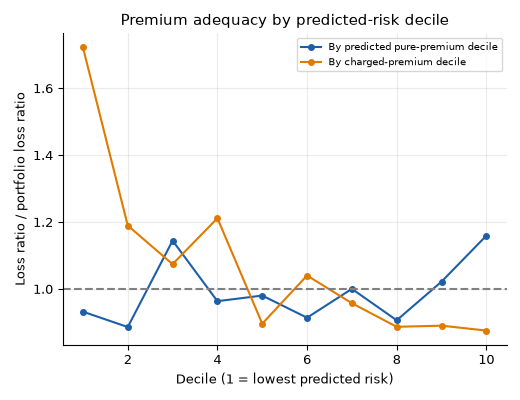

### Reserving: GenIns triangle (10 origin years, cumulative claims)

| Quantity | Value |
|---|---|
| Total chain-ladder IBNR | 18,680,856 |
| Mack standard error (total) | 2,441,364 (CV 13.1%) |
| Bootstrap ODP: mean / std. dev. | 18,848,911 / 3,079,423 |
| Bootstrap reserve P50 / P75 / P95 | 18.67m / 20.82m / 24.30m |
| ODP scale parameter | 52,601 (matches England & Verrall) |

| Origin | Latest | IBNR | Ultimate | Mack s.e. |
|---|---|---|---|---|
| 2001 | 3,901,463 | 0 | 3,901,463 | 0 |
| 2002 | 5,339,085 | 94,634 | 5,433,719 | 71,835 |
| 2003 | 4,909,315 | 469,511 | 5,378,826 | 119,474 |
| 2004 | 4,588,268 | 709,638 | 5,297,906 | 131,573 |
| 2005 | 3,873,311 | 984,889 | 4,858,200 | 260,530 |
| 2006 | 3,691,712 | 1,419,459 | 5,111,171 | 410,407 |
| 2007 | 3,483,130 | 2,177,641 | 5,660,771 | 557,796 |
| 2008 | 2,864,498 | 3,920,301 | 6,784,799 | 874,882 |
| 2009 | 1,363,294 | 4,278,972 | 5,642,266 | 970,960 |
| 2010 | 344,014 | 4,625,811 | 4,969,825 | 1,362,981 |

The three most recent origin years carry most of the reserve: 2008-2010 hold 69% of the IBNR. A P95 reserve is
about 5.6m (30%) above the central estimate. Currency units are not stated in the source data.

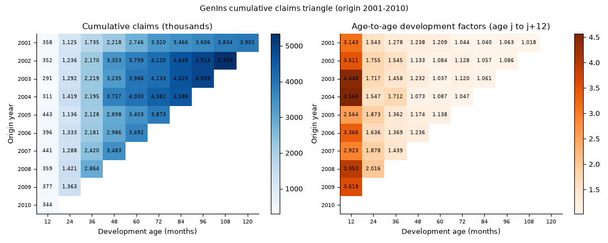

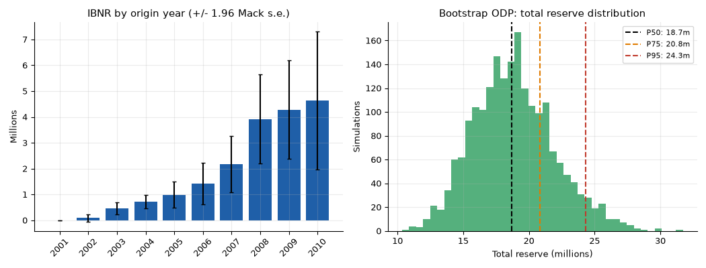

Bornhuetter-Ferguson (CAS CLRD commercial auto, net paid, units of $000, all companies). Triangles with premium are needed for BF;
GenIns has none. The a-priori loss ratio is 0.676, the mean chain-ladder ultimate loss ratio of the five oldest accident years
(an assumption stated for illustration, not a pricing view).

| Origin | % paid-developed | Chain-ladder IBNR | BF IBNR |
|---|---|---|---|
| 1993 | 92.1% | 65,110 | 64,560 |
| 1994 | 84.7% | 139,000 | 135,600 |
| 1995 | 72.1% | 260,700 | 251,600 |
| 1996 | 53.4% | 445,900 | 428,100 |
| 1997 | 26.1% | 771,400 | 684,200 |
| Total (1988-97) | | 1,743,193 | 1,626,765 |

BF pulls the least-developed year (1997, 26% developed) down by 11% relative to the chain-ladder: the a-priori
loss ratio implies fewer unreported losses than extrapolating the early development factors does.

### Severity-anomaly screening (heuristic, no fraud labels)

### Severity-anomaly screening (heuristic, no fraud labels)

> This is a screening heuristic, not a fraud model. The public data contain no fraud labels, so none of this
> is validated against confirmed fraud. Large or unusual claims have many legitimate explanations
> (serious injury, total loss, data errors). Flags are for human review only.

Each claim row (26,444 amounts) is scored against a Gamma severity GLM fitted on the other four folds of policies, so no claim is judged by a model that saw it. A claim is flagged if the tail probability
rule fires, or if two or more reason codes fire.

| Reason code | Rule | Claims firing |
|---|---|---|
| SEV_TAIL | Gamma upper-tail probability under the GLM < 0.001 | 90 |
| SEV_RATIO | Amount > 5x predicted severity | 550 |
| SHORT_EXPOSURE_LARGE | Exposure < 0.15 years and amount > 2x predicted | 227 |
| MULTI_CLAIM | Policy has 3 or more claims | 277 |

164 claims (0.62%) are flagged; they hold 31.9% of all claimed amounts, which is concentrated in a few very large claims.
The top of the list is dominated by amounts of 0.20m to 4.08m against predicted severities of 1,265 to 2,897
(`results/fraud_top_flags.csv`). The severity model varies little across policies (see the severity table above: no gain over the mean),
so in practice the ranking is close to "very large claim". Replace the thresholds with ones tuned on labelled data if you have it.

## Quickstart

## Quickstart

```bash
python3.12 -m venv .venv && source .venv/bin/activate
pip install -e ".[dev]"

ins-ml reconcile                               # how claim counts and amounts line up
ins-ml pricing  --out results --figs docs      # OpenML download (~7 MB), tuning, 5-fold CV
ins-ml spain    --out results --figs docs      # Mendeley download (95 MB), same pipeline, comparison
ins-ml reserving --out results --figs docs     # offline (triangles ship with chainladder)
ins-ml fraud
ins-ml all --synthetic --n 20000               # fully offline run on synthetic portfolios

pytest -q && ruff check .
```

`--reuse-params` skips the Optuna step and reads `results/tuned_params.json`. The Optuna step is the
slow part (four studies of 25 trials); the cross-validated fits take a few minutes more on a laptop.

## Repository layout

```
src/ins_ml/   data.py  features.py  glm.py  gbm.py  cv.py  calibrate.py  metrics.py  pricing.py
              spain.py  reserving.py  fraud.py  plots.py  cli.py
tests/        offset / pure premium / deviance / Gini / folds and groups / balance and isotonic
              correction / loss-ratio table / claims reconciliation / Spanish schema and hash check /
              chain-ladder vs hand-computed triangle / screening
docs/         figures (PNG) and the reserving explainer
results/      CSV and JSON tables behind every number above
.github/workflows/ci.yml   Python 3.12, offline fixtures and a synthetic smoke run
```

Tests use small hand-built tables and seeded synthetic portfolios, so CI needs no network.

## Limitations

- freMTPL2 is one French portfolio from one period with no calendar year, premium or claim development.
  The premium-adequacy view on it rests on an incumbent tariff and a 70% loading that I chose.
- It is not known whether the claims without an amount were closed without payment or not yet valued.
  The pure premium describes observed amounts.
- The Spanish file gives incurred cost per policy-year, not per claim, so severity is not modelled
  there. It has no vehicle age (the column of that name behaves as licence years), and only three years
  of data, the last one still developing.
- Severity is capped at 100,000 per claim; the layer above is not priced.
- Reserving triangles are small, annual and aggregated, and the Bornhuetter-Ferguson a-priori is a
  stated assumption. Bootstrap ODP excludes tail development beyond the observed ages, inflation and
  calendar-year effects.
- The screening module has no labels, so no precision or recall can be stated.

## License

MIT, see [LICENSE](LICENSE). Datasets keep their own terms as listed above.

By Utku Fidan · [utkufidan.com](https://utkufidan.com)
